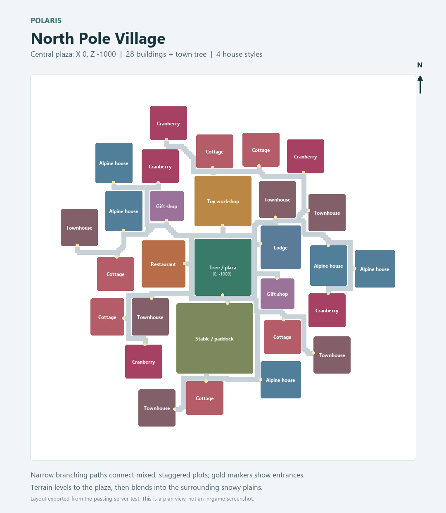

# Polar Dimension

Minecraft **1.21.1** mod using **NeoForge 21.1.264**, ModDevGradle, and **Java 21**.

## Development on Windows

A local Java 21 JDK is available in `.tools/` (ignored by Git). The PowerShell helper selects it and keeps Gradle caches in `.gradle-user-home/`.

```powershell
.\dev.ps1 build
.\dev.ps1 runClient
.\dev.ps1 runServer
.\dev.ps1 runData
```

The built mod JAR is written to `build/libs/`. GeckoLib **4.9.3 for NeoForge 1.21.1** is now required on both client and server. `build` copies its unmodified JAR beside the mod and produces `polar_dimension-0.1.0-with-geckolib.zip`; extract both JARs into `mods/` (replace the older Polar Dimension JAR). The development server requires accepting Minecraft's EULA in `run/eula.txt` before use.

For IntelliJ IDEA, open this folder as a Gradle project and select a Java 21 JDK as both the project SDK and Gradle JVM. On other machines, install JDK 21 and use `gradlew.bat` (Windows) or `./gradlew` (Linux/macOS).

## Project layout

- `src/main/java/com/josep/polardimension/PolarDimension.java`: mod entry point.
- `src/main/resources/assets/polar_dimension/`: textures, models, and translations.
- `src/main/templates/META-INF/neoforge.mods.toml`: mod metadata; Gradle expands properties at build time.
- `src/generated/resources/`: output from data generation.
- `gradle.properties`: mod identity and dependency versions.

Mod ID: `polar_dimension`. Java package: `com.josep.polardimension`. Initial version: `0.1.0`. License metadata: All Rights Reserved.

## Polaris

Polaris (`polar_dimension:polaris`) is a cold, single-biome dimension with rolling plains terrain, snowfall, and permanent midnight. Its solid ground consists of:

- 3-5 blocks of full snow blocks from the surface.
- Packed ice beneath the snow, ending 10-15 blocks below the surface.
- Deepslate below the packed ice, with bedrock at the world floor (Y=-64).

Layer depths vary smoothly by column and follow terrain height. Underground caves and aquifers remain below the continuous frozen crust. Only vanilla iron and gold ore placements are enabled, with their unchanged counts, vein sizes, height distributions, and air-exposure rules. Large iron veins remain enabled; copper veins are suppressed. The frozen crust is not an ore replacement target. Outside the custom North Pole village, there are no natural trees; uncommon abandoned campsites and snowy igloos are scattered through the wilderness. Other ores, natural grass, geodes, surface lava lakes, and vanilla structures are excluded.

Polaris fixes its celestial time at 18000 (midnight), independently of the Overworld clock. Sleeping and `/time set day` do not produce daylight there; the Overworld and other dimensions retain their usual cycles. Game ticks and simulation continue normally.

The cloudless night sky retains vanilla stars and moon, with large pink/purple and green aurora curtains. The custom texture wraps across two broad arcs above the horizon and drifts slowly using game time; snowfall dims it. Terrain occludes it normally, and it is hidden underwater or with blindness/darkness. Auroras are visual and do not emit block light. The texture is `assets/polar_dimension/textures/environment/polaris_aurora.png`; its built-in imagegen prompt is preserved in `art/sky/README.md`. Night-specific wildlife position checks keep penguins and polar bears spawning on exposed snow/ice in Polaris while preserving collision and village exclusions.

Restart the game/server after updating; existing worlds receive the night sky and auroras without regenerating terrain.

With cheats enabled, enter safely above the terrain using:

```mcfunction
/gamemode spectator
/execute in polar_dimension:polaris run tp @s 0 120 0
```

Return with `/execute in minecraft:overworld run tp @s 0 120 0`. Choose a safe landing before leaving spectator mode. Restart the world after adding dimension data; use a new world for generation testing. Already-generated chunks do not change when worldgen settings change.

Worldgen JSON lives in `src/main/resources/data/polar_dimension/`. `worldgen/PolarisChunkGenerator.java` applies the crust before ore decoration and repairs shallow carver cuts so depth is measured from the actual terrain surface, rather than a fixed Y level or each cave floor. Noise-router and biome data are adapted from Minecraft 1.21.1; ordinary ore placements reference vanilla registry entries directly.

## Wilderness structures

Abandoned Snowy Campsites and Snowy Igloos generate unoccupied on Polaris's snow surface, using the original templates from the sibling `minecraft_structure_gen/structures` folder. Copies targeting 1.21.1 are bundled under `structure/wilderness/`; originals remain untouched. Reimport with `python tools/import_wilderness.py --source <structures-folder>` (requires `nbtlib`).

The two types share a native random-spread structure set with equal weights: one candidate per 24-by-24-chunk region, 10-chunk separation, and a 65% placement frequency. Positions and rotations vary by seed. Candidates within a 256-block square radius of the North Pole center, or with more than eight blocks of sampled terrain variation, are rejected. Snow foundations fill small terrain gaps to prevent floating edges. The campsite's ground layer is 2; the igloo's is 1. These structures do not add new mob spawn overrides.

With **Generate Structures enabled**, explore new Polaris chunks after restarting with the update. Existing terrain is not overwritten. Locate them with:

```mcfunction
/execute in polar_dimension:polaris run locate structure polar_dimension:abandoned_snowy_campsite
/execute in polar_dimension:polaris run locate structure polar_dimension:snowy_igloo
```

## North Pole village

One large village generates on the snow surface, with the central Christmas tree at **X=0, Z=-1000**, independent of the world seed. Its surface height follows the seed; it is not placed underground at Y=0. The compact building footprint is about 203 by 194 blocks, within the original level terrain envelope and its 28-block blend into the surrounding plains.

The layout uses all ten imported structure types: six cottages, six townhouses, five Alpine houses, five Cranberry cottages, a lodge, two gift shops, a restaurant, **exactly one toy workshop with its basement**, a stable/paddock, and the tree plaza. Mixed house styles face different directions on staggered plots, typically separated by 4–6 blocks. Three-block branching paths bend between buildings and connect every entrance to the plaza; low lantern posts follow the paths. The village has 31 passive elves (18 male and 13 female), four rideable reindeer, and two iron golems. Residents follow the imported beds; these are initial populations, not automatically replenished NPCs.



To visit above the village with cheats enabled:

```mcfunction
/gamemode spectator
/execute in polar_dimension:polaris run tp @s 0 140 -1000
```

You can also locate it with `/execute in polar_dimension:polaris run locate structure polar_dimension:north_pole_village`.

Generation uses native saved structure starts and pieces, with only one allowed start chunk `(0, -63)`. Buildings place within chunk boundaries and retain their rotations when saved. The village generates as its area is explored, with **Generate Structures enabled**. Restart Minecraft after updating the mod. Use a new world, or an existing world where this area has never generated; existing buildings and terrain are not regenerated. The road and resident upgrades described below also work in existing villages.

Roads have occasional low spruce-fence lantern posts. Stone-brick and cobblestone paving uses matching light-emitting blocks to keep the entire road clear of snow; they retain ordinary paving drops and pickaxe mining. Existing village paving upgrades and thin snow clears when its chunks load. Restart after updating and revisit the village; no new world is needed for this upgrade. Full snow-block terrain and decorations above the paving remain intact.

Templates are bundled in `src/main/resources/data/polar_dimension/structure/village/`. They were imported from the sibling `minecraft_structure_gen/structures` project into 1.21.1 copies, with additional beds/elf residents and repairs for unsupported lanterns and carpets. Originals are untouched. The workshop uses ground layer 7 so its basement stays underground; other templates use layer 1.

To reimport source assets, install `nbtlib` and run `python tools/import_village.py --source <structures-folder>`. The GameTests validate every imported block/property against the 1.21.1 registries. After tests, `python tools/render_village_map.py` (requires Pillow) regenerates the layout image from the test report. Template metadata is recorded in `structure/village/manifest.json`; the bundled plan is `structure/village/layout.json`, read by `village/VillageLayout.java`. Run `python tools/plan_village.py` after importing to rebuild the compact layout, routes, and lantern positions. The planner uses a fixed random seed to mix homes reproducibly, so the layout stays the same across world seeds and chunk exploration orders. Use `python tools/render_village_map.py --plan` to preview a design before running tests.

## Elf residents

The North Pole village uses your Christmas Elf and Female Christmas Elf models, with their original 64x64 textures and native walking/head-look animations. Fresh village templates spawn 18 male and 13 female elves. Elves have 20 health, open and close doors, wander near their saved home, look at nearby players/residents, and flee monsters or damage. Village wandering targets stay inside the settlement; displaced residents try to return home. They do not despawn when players move away. They are passive mobs without villager trading, jobs, or breeding.

Existing vanilla villagers inside the North Pole village bounds in Polaris convert to elves when loaded. Their position, name, health, AI setting, and tags are preserved. Villagers elsewhere in Polaris and all Overworld villagers stay unchanged. Restart the game/server after updating and visit the village to load its residents; a new world is not required for this conversion. Existing dead or missing residents are not replenished.

Both varieties have creative spawn eggs and can be summoned:

```mcfunction
/summon polar_dimension:christmas_elf ~ ~ ~
/summon polar_dimension:female_christmas_elf ~ ~ ~
```

Elves spawned inside the Polaris village bind to a home there; elves spawned elsewhere are ordinary wandering passive mobs. Taking an elf to another dimension releases its old village restriction.

Source models are kept in `art/elves/`; `node tools/export_elf_models.cjs` regenerates the Java model layers. The exporter preserves all 15 male/19 female cubes, bone pivots, rotations, and box UVs. Entity logic is in `entity/`, and renderers/models are isolated in `client/`.

## Disheveled Santa basement encounter

Disheveled Santa is a persistent, one-time mob in the unique toy workshop basement. His initial anchor is local template position `(17, 1, 12)`, one block above the basement's wooden floor. The spawner reads the saved workshop piece's actual position and rotation, supporting older village layouts as well as new worlds. It runs when a player approaches the village and the basement chunk is loaded, and waits if the spawn space has been obstructed. An encounter UUID is saved per Polaris world; unloading, restarting, or defeating Santa does not create another copy. Destroyed or absent workshops are not rebuilt.

Santa wanders within eight blocks of his saved basement home and stays on its floor level. A slow, heavy walk cycle adds alternating steps, torso sway, and head counter-motion inspired by a warden. The original 29 cubes, 10 bones, texture, and 404 authored keyframes are retained. The three original actions are imported as five clips: `ritual_start`, `ritual_chant`, `ritual_end`, `axe_swing`, and `frost_breath`. The original files are preserved in `art/disheveled_santa/`; `node tools/export_santa_gecko.cjs` rebuilds GeckoLib geometry/animation resources and adds separate idle/walk clips.

Health (600), movement speed (0.18), and the nearby red boss bar remain provisional. Santa now acquires survival/adventure players in his basement and uses the axe swing as a real attack. The axe deals **60 base damage** once at tick 17 (0.85 seconds), in a 90-degree frontal cone reaching 3 blocks, within 2.5 blocks vertically. Facing is locked for the 33-tick animation; victims are checked at impact, so dodging behind him avoids the cleave. Walls, scoreboard allies, other Santas, creative/spectator players, armor, and normal difficulty rules are respected. The cooldown is 80 ticks between attack starts and persists across saves. Damage is server-authoritative; no extra vanilla contact-melee hits are added. At range, frost breath deals one 10-base-damage sonic-boom hit at tick 16 (0.8 seconds), bypassing walls, armor, and shields like the warden. It uses the same resistance-scaled knockback, with a 15-block horizontal/20-block vertical range subject to basement boundaries. A white sparkling beam with scattered snowflakes continues through the blowing phase (0.8-2.2 seconds); this visual trail does not repeatedly deal damage. The 56-tick animation is followed by a 40-tick cooldown. The ritual raises his arms, chants once, and lowers them (5.6 seconds total). At tick 56, two seconds into the chant, it summons five evil elves on clear nearby floor positions. Black dust swirls around him during the raising/chanting phases. Santa and his summoned elves are allies; owner identity and the 30-second ritual cooldown persist across saves. Ritual becomes available after an initial 10-second delay and takes priority when ready in combat. If five clear positions are unavailable, summoning waits for another cast instead of spawning inside blocks. Encounter loot is still pending. Santa stays persistent even in Peaceful so the static encounter is not accidentally lost. Existing mobs retain their native renderers; only Santa uses GeckoLib.

For visual testing, use a Disheveled Santa Spawn Egg or `/summon polar_dimension:disheveled_santa ~ ~ ~`. Manual spawns do not claim the unique workshop encounter. With cheats/operator permission, preview the nearest Santa within 64 blocks:

```mcfunction
/santa_animation axe_swing
/santa_animation frost_breath
/santa_animation ritual
```

Previews pause movement and apply no combat effects, including the axe, frost-breath, and ritual previews. Normal combat can resume after a preview finishes. Ritual plays the start, one chant cycle, then the ending. Combat timing is server-controlled and follows the supplied animation cues. Restart with **both mod JARs installed** and revisit the workshop; an existing generated village does not need to be regenerated.

## Evil Christmas Elf

The evil elf uses the original 15-cube, six-bone model and 64x64 texture in `art/evil_elf/`, with native walk/look/melee animations. Regenerate it with `node tools/export_evil_elf_model.cjs`. It has 20 health, movement speed 0.40 (about 1.74 times a normal zombie), 5 base melee damage (stone-sword equivalent), and attack knockback 2.0 (the same extra knockback as Knockback II). Standard difficulty scaling, armor, and knockback resistance apply. Damage/knockback are intrinsic attributes; no weapon is equipped to double the bonus. Existing vindicator sounds are reused, and item loot is currently empty.

It targets and damages only survival/adventure players. All non-player mobs are protected, including passive wildlife, villagers, friendly elves, and iron golems; it does not retaliate against them. Santa summons five during his ritual attack; there is no natural biome spawning. Polaris's regular hostile lists remain strays and evil snowmen. Use the Evil Christmas Elf Spawn Egg or `/summon polar_dimension:evil_christmas_elf ~ ~ ~` for manual testing.

## Hostiles and evil snowmen

Polaris's regular hostile spawn list contains only vanilla strays (weight 80, groups 1–4) and evil snowmen (weight 100, groups 1–3). Both use normal monster population, difficulty, darkness, and collision rules. Other natural hostile placements and insomnia phantom attempts are blocked in Polaris; other dimensions keep their existing spawns. Monsters already present are not removed, and manual spawn eggs/summons remain available.

Evil snowmen use the original 16-cube, 128x128 model/texture in `art/evil_snowman/`, including the icicle parented to the right arm. They have 20 health, 2 armor, movement speed 0.46 (twice a zombie's 0.23), and 6 base melee damage (an iron sword's fully charged base attack). Standard difficulty scaling, armor, and attack timing still apply. They pursue players, villagers, and iron golems. Both elf varieties are protected from their targeting and melee, including retaliation; they have no ranged attack, zombie reinforcements, or conversions. The icicle is visual geometry rather than extra equipped weapon damage. Drops are 0–2 snowballs; existing snow-golem sounds are reused.

Use the Evil Snowman Spawn Egg or `/summon polar_dimension:evil_snowman ~ ~ ~` to test. Regenerate its model with `node tools/export_evil_snowman_model.cjs`. Restart after updating; new hostile spawn rules apply to existing worlds without regenerating terrain.

## Penguins and wild spawning

Penguins use the original eight-cube model and 64x64 texture from `art/penguin/`, with head tracking, waddling feet, flipper movement, and half-size babies. They are passive animals with 10 health: they wander, flee damage, follow parents, and breed with raw cod or salmon. Existing vanilla chicken sounds are reused; they do not lay chicken eggs.

Death loot delegates directly to `minecraft:entities/chicken`: feathers and raw chicken, cooked chicken when burning, with vanilla Looting behavior. A Penguin Spawn Egg is available in the creative spawn-egg tab; `/summon polar_dimension:penguin ~ ~ ~` also works. Regenerate the native model with `node tools/export_penguin_model.cjs`.

Polaris's only regular non-hostile wildlife spawns are penguins (weight 10, groups 2–4) and vanilla polar bears (weight 1, groups 1–2). Snow-compatible spawn rules allow both on the frozen surface. Rabbits, bats, and glow squid are removed from the biome's spawn lists. Natural and chunk-generation wildlife spawns are excluded from the North Pole village bounds; its template elves, reindeer, and golems remain. Polar bears retain their vanilla behavior, including aggression when provoked or protecting cubs.

Restart the game/server after updating. Spawn-list changes apply in existing worlds, but animals already present are not removed, and manual summons, spawn eggs, and breeding remain available. Explore new Polaris chunks for initial wildlife groups; later passive spawning still follows Minecraft's normal population limits. Other dimensions' spawn lists are unchanged.

## Reindeer mounts

The supplied reindeer model and 128x128 atlas are used for a native horse-based mob: tame by riding, equip a saddle, then use normal horse steering and the charged jump bar. Feeding, horse inventory, armor, ownership, growth, and breeding use the vanilla horse implementation. Paired reindeer produce reindeer offspring with normal inherited horse stats. The model includes walking/head/eating animations, baby scaling, a saddle visible when equipped, and a torso armor layer using the equipped horse armor texture (including leather dye).

**Jump height is 1.5 times that of a horse with the same jump-strength attribute and jump charge.** The jump-strength attribute itself stays unchanged, preventing the bonus from stacking through saves or breeding. The launch speed is solved against vanilla's per-tick gravity and drag. This describes unobstructed ground jumps; ceilings and ordinary environmental effects still affect movement.

Fresh village stables spawn four reindeer. Existing or newly spawned vanilla horses anywhere in **Polaris only** convert when loaded/added. Conversion retains saved horse data, including taming, owner, health, speed/jump stats, saddle, armor, age, and custom name, and transfers passengers/leashes. Horses in the Overworld and other dimensions remain horses. Restart and load the relevant chunks; a new world is not required for conversion.

A Reindeer Spawn Egg is available in the creative spawn-egg tab, or use `/summon polar_dimension:reindeer ~ ~ ~`. The source model is retained in `art/reindeer/`; regenerate the native model with `node tools/export_reindeer_model.cjs`. The collision body stays horse-sized; antlers are visual geometry above it. Antlers splay outward with corrected Blockbench-to-Minecraft rotations. Their geometry is hidden only for the mounted local player in first-person view to keep the camera clear; third-person and other players still see the antlers. The exporter checks every antler corner for centerline clearance.

## Blue-ice portal

Build a vertical Nether-portal-shaped frame entirely from **blue ice**. The smallest frame is 4 blocks wide by 5 blocks tall, with a 2-by-3 opening; corners are optional. Larger openings up to 21-by-21 work in either horizontal orientation.

Right-click an inside face of the frame with a **nether star**. Successful activation consumes one star in survival; creative activation is free. Invalid or already-lit frames do not consume stars. Flint and steel does not activate this portal.

The vertical portal has an animated, violet-tinted **End portal starfield**, purple particles, and portal sounds. Stand inside to travel between the Overworld and Polaris at 1:1 coordinates. Normal Nether-portal entry delays and cooldowns apply. Existing Polaris portals within 128 blocks are reused; otherwise, travel builds a blue-ice return portal using vanilla-style placement and a fallback landing platform. Breaking the frame collapses the portal. Activation is restricted to the Overworld and Polaris.

## Integration tests

```powershell
.\dev.ps1 -PpolarisTests runGameTestServer
```

These opt-in NeoForge GameTests check 1,024 terrain columns plus portal activation, item consumption, both frame orientations, frame limits, collapse, portal lookup, entity round-trip travel, and village placement/population/template compatibility, and elf residency/persistence/scoped migration, and reindeer riding, breeding, equipment, horse conversion, and 15 actual jump-height comparisons. Road tests cover existing-chunk upgrades, lantern placement, vanilla snow melting and accumulation rules, and preserved decorations and drops. The GameTest server disables automatic structures, so the village test explicitly invokes Minecraft's native start-generation and chunk-placement methods on generated Polaris terrain. Penguin tests also exercise native snow-surface spawning, wildlife restrictions, breeding/save behavior, and chicken loot parity with fire and Looting. Tests and their empty structure template live in `src/gameTest/` and are excluded from the release JAR. The test uses an isolated development world in `run/polaris-tests/world/`, which is deleted and regenerated on each test run. Do not place player saves in that directory. A test-only flat-world preset includes Polaris because the GameTest server otherwise creates only vanilla dimensions.

Based on the official NeoForge MDK: https://github.com/NeoForgeMDKs/MDK-1.21.1-ModDevGradle
Documentation: https://docs.neoforged.net/docs/1.21.1/gettingstarted/


## Santa merchant reward

Defeating the recorded Big Nicky in the workshop unlocks a single invulnerable Santa beside the central village tree. The unlock and merchant UUID persist across saves; spawning waits for loaded chunks and clear space. Manual Big Nicky spawns do not unlock a merchant. Kills before installing this update cannot be inferred from old save data.

Santa uses the preserved `art/giant_santa/` model (20 cubes, 128x128 texture) with a simple passive walk. Re-export with `node tools/export_friendly_santa_model.cjs`. He stays near his saved tree-side home, does not despawn, and opens the standard trading screen on interaction. His only repeatable trade is **32 emerald blocks + 1 nether star for 1 Big Nicky spawn egg**, with no price changes or restock requirement. Manual testing: `/summon polar_dimension:giant_santa ~ ~ ~` or the Santa Spawn Egg.

## Polaris navigation and wilderness supplies

Ordinary compasses in Polaris point to X=0, Z=-1000 using vanilla compass wobble. Lodestone and recovery compasses retain their normal targets, and other dimensions are unchanged. Newly generated campsite and igloo chests/barrels use `chests/polaris_wilderness`: 2-4 weighted supply rolls, with compasses (weight 1), 1-4 cobwebs (weight 3), or 4-12 snowballs (weight 6). Village and other containers are untouched; existing generated containers are not refilled.

Village chests/barrels generated after this update use `chests/polaris_village`, with 3-6 weighted rewards: 1-4 iron ingots, 2-8 gold nuggets, 2-6 cookies, 1-2 pumpkin pies, or one cake (rare). This applies only to the Polaris village structure; wilderness loot remains separate and existing containers are not refilled.

Village interiors receive supported wall torches, including the upper floors of houses. The lighting plan is generated from imported geometry by `tools/plan_interior_lighting.py` (also run by the village importer). Existing saved village pieces receive the same additive fixtures when players revisit Polaris; only empty planned positions with their original supporting wall are used, preserving player blocks. No village regeneration is needed.
